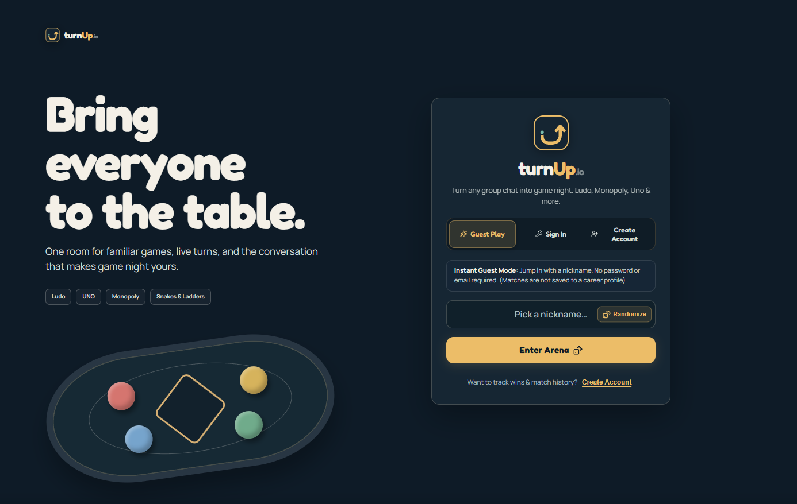
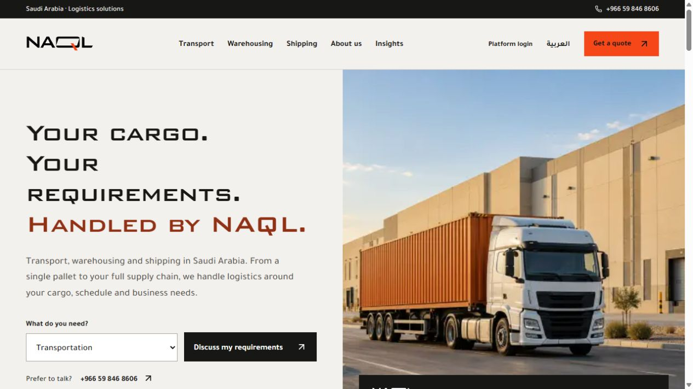
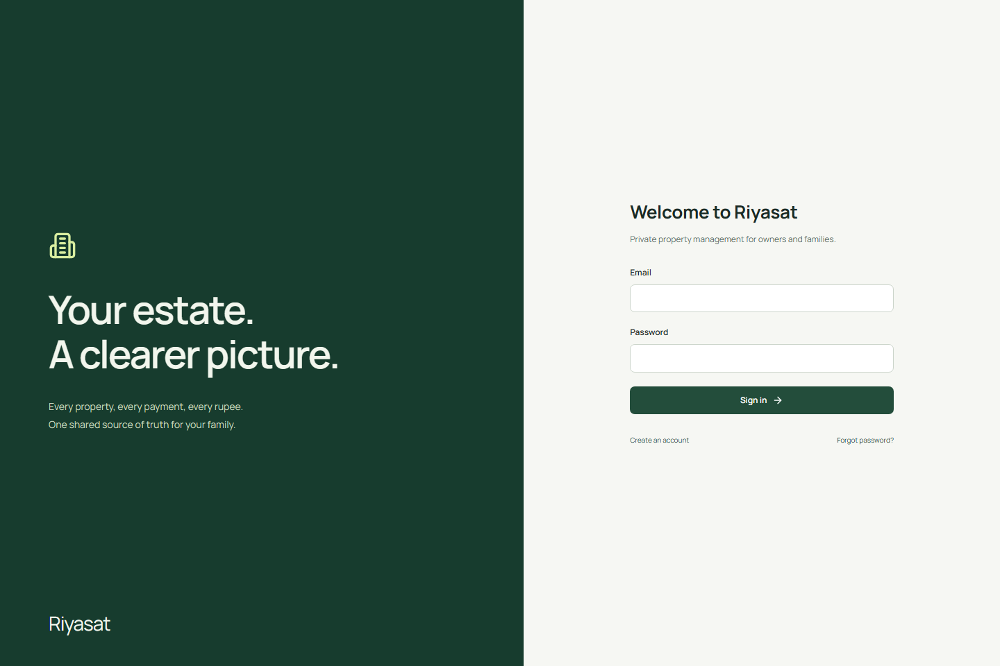
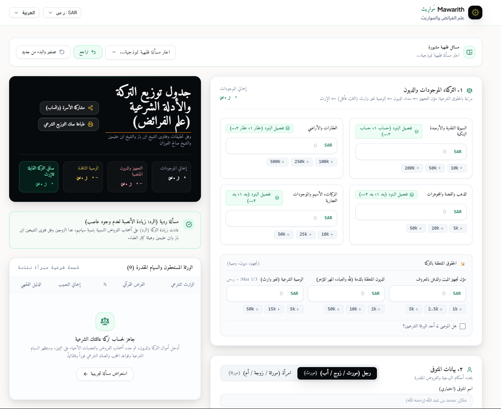

<a href="https://sufyanfarooq.com/"></a>

<p>
  <a href="https://sufyanfarooq.com/"></a>
  <a href="https://sufyanfarooq.com/assets/cv/Sufyan_Farooq_CV.pdf"></a>
  <a href="https://www.linkedin.com/in/sufyanmfarooq/"></a>
  <a href="mailto:sufyanfarooqsmf@gmail.com"></a>
  <a href="https://wa.me/966544882306"></a>
</p>

By day I keep a university learning platform working for 2,000+ students and staff (Digival, since March 2023). The rest of the time I build apps, run them on my own Oracle Cloud VM, and automate the boring parts with Python, n8n and AI agents. The terminal above is drawn live by that server.

## Things I built and keep running

<table>
  <tr>
    <td width="50%" valign="top">
      <a href="https://turnup.sufyanfarooq.com/"></a>
      <h3><a href="https://github.com/Sufyan-Farooq/TurnUp.io">TurnUp</a></h3>
      Realtime multiplayer board games. Docker Compose on Oracle Cloud, GitHub Actions deploys, health checks, database backups and rollback.
      <p>
        <a href="https://turnup.sufyanfarooq.com/"></a>
        <a href="https://github.com/Sufyan-Farooq/TurnUp.io"></a>
      </p>
      <code>React</code> <code>Socket.io</code> <code>PostgreSQL</code> <code>Docker</code>
    </td>
    <td width="50%" valign="top">
      <a href="https://naqlapp.com/"></a>
      <h3><a href="https://naqlapp.com/">naqlapp</a></h3>
      Logistics site and Truck Dispatcher TMS for a client: dispatch, fleet and driver assignment, delivery evidence, billing readiness.
      <p>
        <a href="https://naqlapp.com/"></a>
        
      </p>
      <code>React</code> <code>TypeScript</code> <code>Node.js</code> <code>PostgreSQL</code>
    </td>
  </tr>
  <tr>
    <td width="50%" valign="top">
      <a href="https://riyasat.sufyanfarooq.com/"></a>
      <h3><a href="https://github.com/Sufyan-Farooq/Riyasat">Riyasat</a></h3>
      Property management for owners and families: agreements, payments, maintenance, reports and role-based access.
      <p>
        <a href="https://riyasat.sufyanfarooq.com/"></a>
        <a href="https://github.com/Sufyan-Farooq/Riyasat"></a>
      </p>
      <code>Next.js</code> <code>TypeScript</code> <code>Supabase</code>
    </td>
    <td width="50%" valign="top">
      <a href="https://mawarith.sufyanfarooq.com/"></a>
      <h3><a href="https://github.com/Sufyan-Farooq/Mawarith">Mawarith</a></h3>
      Public beta of an Islamic inheritance calculator with a typed calculation engine and an Arabic interface.
      <p>
        <a href="https://mawarith.sufyanfarooq.com/"></a>
        <a href="https://github.com/Sufyan-Farooq/Mawarith"></a>
      </p>
      <code>React</code> <code>TypeScript</code> <code>Arabic UI</code>
    </td>
  </tr>
</table>

<details>
<summary><b>How sufyanfarooq.com ships</b></summary>

```text
git push main
  └─ GitHub Actions: syntax check · node tests · shell lint · docker build
       └─ ssh (pinned host key, restricted key) → Oracle Cloud VM
            └─ docker compose up · memory cap · log rotation · persistent stats
                 └─ health check  ── fail → roll back to the previous image
```

One VM on purpose: small traffic, every moving part visible. The trade-off is no redundancy, and the live board records it when something goes down. [Source](https://github.com/Sufyan-Farooq/sufyanfarooq.com)
</details>

<details>
<summary><b>AI agents and automation</b></summary>

- **Bilingual voice booking agent:** answers in Arabic or English, checks availability, books, and hands off to a human. Vapi/Retell, OpenAI, n8n, webhooks.
- **WhatsApp AI sales agent:** qualifies leads from Meta ads and passes them to consultants. n8n, OpenAI tool calling, WhatsApp Business API.
- **Health monitoring daemon:** polls endpoints, records latency and status in SQLite, alerts with backoff. Python.
- **This profile:** the "Shipped lately" table below is rewritten every day by a GitHub Action in this repo.
</details>

<details>
<summary><b>At work: Digival IT Solutions, March 2023 to now</b></summary>

Senior Onsite Support Engineer on university learning platforms.

- Exam-readiness dashboard: daily checks from **about 2 hours to under 5 minutes**.
- **50+ defects** escalated with the exact failing request, reproduced with logs, Postman and cURL.
- Traced missing platform emails to queuing in the AWS email service.
- Arabic and English runbooks; ticket response times **down 30%**, **98%** satisfaction.
</details>

## Tools

<p>
  <b>Run</b>&nbsp;
  
  
  
  
  
  
  
</p>
<p>
  <b>Build</b>&nbsp;
  
  
  
  
  
  
</p>
<p>
  <b>Automate</b>&nbsp;
  
  
  
  
  
</p>
<p>
  <b>Learning</b>&nbsp;
  
  
  
  
  
  
</p>

## Shipped lately

<!-- SHIPPED:START -->
| Repo | Latest commit | Date |
|---|---|---|
| [sufyanfarooq.com](https://github.com/Sufyan-Farooq/sufyanfarooq.com) | [Check the status board in the server deploy health check](https://github.com/Sufyan-Farooq/sufyanfarooq.com/commit/11b0ef90a28c304e3fe2ed32c1946fe3bad9496b) | 2026-10-30 |
| [TurnUp.io](https://github.com/Sufyan-Farooq/TurnUp.io) | [Cap memory for turnup containers on Oracle](https://github.com/Sufyan-Farooq/TurnUp.io/commit/a47bedf4d6a1a54a2b226b095da3450290400a03) | 2026-10-28 |
| [Mawarith](https://github.com/Sufyan-Farooq/Mawarith) | [Remove AI advisor and add Docker deployment](https://github.com/Sufyan-Farooq/Mawarith/commit/d89f8aee8e9de27e5f2fc3d6b31a81f84dd3c4f2) | 2026-09-27 |
| [Riyasat](https://github.com/Sufyan-Farooq/Riyasat) | [Fix password recovery and add Google sign-in](https://github.com/Sufyan-Farooq/Riyasat/commit/73f20087a93c878ca1d34f6e499d59e920ad4e23) | 2026-10-07 |
| [far-and-found-travel-template](https://github.com/Sufyan-Farooq/far-and-found-travel-template) | [Expand featured destinations and lower WhatsApp button](https://github.com/Sufyan-Farooq/far-and-found-travel-template/commit/cfc8dbcf3da418e394363eac0f4796cf6b8feafc) | 2026-09-28 |
<!-- SHIPPED:END -->

<sub>BCA, Osmania University (2025) · MBA in progress · Arabic, English, Hindi, Urdu · Jeddah, open to relocating</sub>
